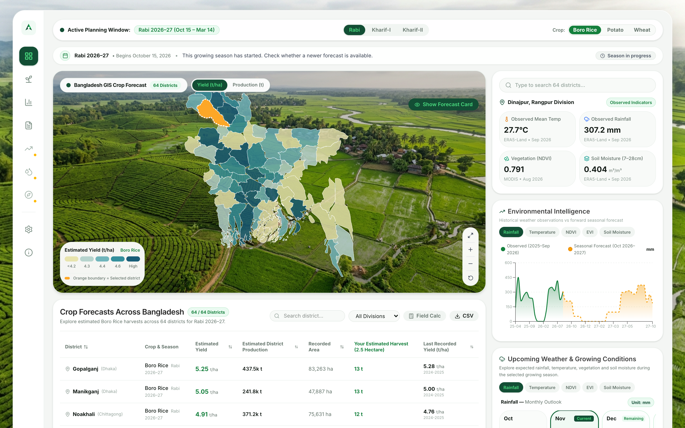

<div align="center">

# 🌾 Bangladesh Crop Outlook

### GIS & AI-Based Crop Yield and Production Forecasting for Bangladesh



<p align="center">
  <a href="https://github.com/WashimAkram1134/Bangladesh_CropOutlook">
    
  </a>
  
  
  
  
  
  
  
  
  
</p>

**A production-quality, district-level agricultural intelligence platform serving AI-driven crop yield and production forecasts across all 64 districts of Bangladesh — powered by Random Forest, SARIMA time-series models, ERA5-Land climate data, and NASA MODIS satellite imagery.**

[🗺️ Dashboard](#-dashboard--pages) · [⚙️ Tech Stack](#%EF%B8%8F-technology-stack) · [🤖 AI & Models](#-ai--forecasting-system) · [🚀 Getting Started](#-getting-started) · [📡 API Reference](#-api-reference) · [📊 Data Sources](#-data-sources)

</div>

---

## 📌 Overview

**Bangladesh Crop Outlook** is an end-to-end agricultural decision-support system designed for agronomists, planners, and policymakers in Bangladesh. It delivers pre-season crop yield forecasts and estimated production figures for **6 crops** across **all 64 districts** using a verified, frozen research model release (**EXP_36**).

The platform combines:
- 🧠 **Random Forest** yield regression trained on 20+ years of BBS agricultural records
- 📡 **SARIMA** seasonal time-series forecasts for 5 environmental variables per district
- 🛰️ **ERA5-Land (ECMWF)** climate reanalysis data (rainfall, temperature, soil moisture)
- 🌿 **MODIS MOD13A3 (NASA)** satellite vegetation indices (NDVI, EVI)
- 🗺️ **Interactive MapLibre GIS** choropleth maps for spatial yield visualization
- 💰 **Smart Crop Planner** with market price simulation and earnings estimation in BDT

---

## 🗺️ Dashboard & Pages

| Page | Route | Description |
|---|---|---|
| **Dashboard** | `/` | GIS yield map, forecast cards, 64-district outlook table, right analytics panel |
| **District Explorer** | `/district-explorer` | Choropleth map across all districts, national ranking, yield-tier comparison |
| **Forecast Comparison** | `/forecast-comparison` | Side-by-side multi-crop and multi-season forecast analysis |
| **Methodology** | `/methodology` | Model specification, data provenance, evaluation metrics, limitations |
| **Smart Crop Planner** | *(embedded in `/`)* | Per-district crop suitability, earnings, net-return calculator |

---

## ⚙️ Technology Stack

### Frontend — `apps/web`

| Layer | Technology | Version |
|---|---|---|
| Framework | Next.js (App Router) | 16.4.2 |
| Language | TypeScript | ^5 |
| Styling | Tailwind CSS | v4 |
| GIS Mapping | MapLibre GL JS | ^6.14.0 |
| Charts | Recharts | ^3.10.1 |
| Icons | Lucide React | ^1.58.0 |
| Date Utilities | date-fns | ^4.4.0 |
| Testing | Vitest + Testing Library | ^5.0.5 |
| Linting | ESLint (Next.js config) | ^9 |

### Backend — `services/api`

| Layer | Technology |
|---|---|
| Framework | Python FastAPI |
| Data Processing | Pandas |
| Schema Validation | Pydantic v2 |
| Server | Uvicorn |
| Forecasting Data | Pre-computed EXP_36 release (CSV/JSON) |

### Monorepo

| Tool | Description |
|---|---|
| npm Workspaces | Monorepo orchestration (`apps/*`, `services/*`) |
| Node.js ≥ 18 | Required runtime |

---

## 🤖 AI & Forecasting System

### Model Release: `EXP_36`

This application is a **read-only operational UI** over the verified **EXP_36** research model release. All forecasts are pre-computed snapshots — no training or model mutation occurs at runtime.

```
EXP_36 Release Summary
├── 384 district-crop yield & production forecast records (64 districts × 6 crops)
├── 320 converged SARIMA operational environmental models
│    └── 5 variables × 64 districts (rainfall, temperature, NDVI, EVI, soil moisture)
├── 64 Bangladesh districts across 8 divisions
├── 3 planning seasons (Rabi · Kharif-I · Kharif-II)
└── Historical agricultural + environmental input data: 2000–2026
```

### 🌾 Yield Model — Random Forest Regressor

- **Target variable:** Crop yield in tonnes per hectare (t/ha)
- **Training data:** BBS agricultural census records 2006–2024
- **Features:** Seasonal rainfall, mean temperature, NDVI, EVI, soil moisture (7–28 cm), soil pH, elevation, district ID, crop type, season

**Per-crop typical yield difference (MAE):**

| Crop | Typical Diff (MAE) |
|---|---|
| Aman Rice | ≈ 0.144 t/ha |
| Aus Rice | ≈ 0.165 t/ha |
| Jute | ≈ 0.103 t/ha |
| Boro Rice | ≈ 0.214 t/ha |
| Wheat | ≈ 0.294 t/ha |
| Potato | ≈ 1.379 t/ha |

### 📈 Environmental Forecasting — SARIMA

320 operational SARIMA models forecast future monthly values of 5 environmental variables across all 64 districts, extending beyond the latest observed satellite/climate data to cover future planning season windows.

| Variable | Source | Coverage |
|---|---|---|
| Monthly Rainfall (mm) | ERA5-Land (ECMWF) | 2000–Sep 2026 |
| Mean Temperature (°C) | ERA5-Land (ECMWF) | 2000–Sep 2026 |
| Soil Moisture 7–28 cm (m³/m³) | ERA5-Land (ECMWF) | 2000–Sep 2026 |
| NDVI Vegetation Index | MODIS MOD13A3 (NASA) | 2000–Aug 2026 |
| EVI Enhanced Veg. Index | MODIS MOD13A3 (NASA) | 2000–Aug 2026 |

---

## 🗓️ Season Calendar & 70% Rollover Rule

```
Season     Window                       Crops
──────────────────────────────────────────────────────
Rabi       Oct 15 → Mar 14 (next yr)   Boro Rice · Potato · Wheat
Kharif-I   Mar 15 → Jul 14             Aus Rice · Jute
Kharif-II  Jul 15 → Oct 14             Aman Rice
```

> **70% Rollover Rule:** When ≥ 70% of the current season has elapsed, the planning interface automatically advances to the *next* season as the active planning window. This ensures farmers and planners always see the most decision-relevant horizon.

**Forecast Advisory Cases (EXP_38 date-aware logic):**

| Case | Status | Message |
|---|---|---|
| A | Season in progress | "This growing season has started. Check for a newer forecast." |
| B | Upcoming — recheck future | "Recommended time to check again: {date}." |
| C | 3rd planning season | Advance forecast advisory |
| D | Past recheck window | "Check whether a newer forecast is available." |
| E | Season concluded / unsupported | "An updated forecast is needed." |

---

## 🗺️ GIS & Spatial Features

- **MapLibre GL JS** choropleth map rendered over OpenFreeMap tiles
- Full **64-district GeoJSON** boundary layer (`bangladesh_districts.geojson`)
- Interactive district click-to-select with floating forecast card
- **Yield tier** and **national rank** overlaid per district
- Toggle between **Yield (t/ha)** and **Production (tonnes)** map metrics

---

## 🌱 Smart Crop Planner

An embedded decision-support tool that lets any farmer or agronomist:

- Select any of the **64 districts**
- Enter **cultivated land area** in Hectares, Acres, or Bigha (auto-converts)
- Input optional **cultivation cost** in BDT/unit
- Get **ranked crop recommendations** by estimated sales or net return
- Customize **market selling prices** per crop (editable, resets to defaults)
- View **earnings comparison charts** across all 6 crops and 3 seasons
- **Export planner results as CSV** with full provenance metadata

**Reference prices (DAM wholesale, 2025–2026):**

| Crop | Sample Price |
|---|---|
| Boro Rice | ৳ 36.00 / kg paddy |
| Aman Rice | ৳ 34.00 / kg paddy |
| Aus Rice | ৳ 32.00 / kg paddy |
| Wheat | ৳ 36.00 / kg |
| Potato | ৳ 22.00 / kg |
| Jute | ৳ 3,862.50 / maund (37.32 kg) |

---

## 📁 Project Structure

```
Bangladesh_CropOutlook/
├── apps/
│   └── web/                              # Next.js 16 frontend
│       ├── app/
│       │   ├── page.tsx                  # Dashboard (GIS map + planner)
│       │   ├── district-explorer/        # Choropleth District Explorer
│       │   ├── forecast-comparison/      # Multi-crop/season comparison
│       │   └── methodology/              # Model docs & data provenance
│       ├── components/
│       │   ├── layout/                   # Navbar, Sidebar, ShellLayout
│       │   ├── ui/                       # Card, Badge, Skeleton, EmptyState
│       │   ├── dashboard/                # ForecastCards, EnvPanels, ArcGauge,
│       │   │                             #   SeasonSelector, DistrictSelector,
│       │   │                             #   CropSelector, BottomOutlookTable,
│       │   │                             #   RightAnalyticsPanel
│       │   ├── district-explorer/        # DistrictChoroplethMap, HistoricalTrendsPanel
│       │   ├── map/                      # CenterVisualMap, MapComponent, FloatingMapCard
│       │   ├── methodology/              # MethodologyContent
│       │   └── planner/                  # SmartCropPlanner
│       ├── lib/
│       │   ├── api.ts                    # Typed FastAPI client
│       │   ├── types.ts                  # Shared TypeScript interfaces
│       │   ├── season.ts                 # Season logic + 70% rollover rule
│       │   ├── forecastAdvisory.ts       # Date-aware advisory (EXP_38)
│       │   ├── landUnits.ts              # Hectare/Acre/Bigha conversions
│       │   ├── districts.ts              # 64-district reference data
│       │   └── utils.ts                  # cn(), formatNumber(), calcProduction()
│       ├── public/
│       │   ├── geo/                      # bangladesh_districts.geojson
│       │   └── images/                   # Agri background assets
│       └── __tests__/                    # Vitest unit tests
│           ├── dashboardRefinements.test.tsx
│           ├── forecastAdvisory.test.ts
│           ├── landUnits.test.ts
│           ├── methodology.test.tsx
│           ├── season.test.ts
│           └── utils.test.ts
├── services/
│   └── api/                              # Python FastAPI backend
│       ├── main.py                       # Full REST API (EXP_36 data server)
│       ├── requirements.txt              # fastapi · uvicorn · pandas · pydantic
│       └── test_api.py                   # API integration tests
├── private/
│   └── exp_36_release/                   # EXP_36 verified model release (private)
│       └── EXP36_20261016T035235Z_.../
│           ├── deployment_contract.json
│           ├── forecasts/national_384_predictions.csv
│           ├── audits/sarima_operational_320_fit_status.csv
│           ├── inputs/Historical_Agriculture_Weather_RS_GIS_2006_2026.csv
│           └── evaluation/
├── package.json                          # Monorepo root (npm workspaces)
└── README.md
```

---

## 🚀 Getting Started

### Prerequisites

- **Node.js** ≥ 18 (tested on Node 26)
- **npm** ≥ 10
- **Python** ≥ 3.11 (for backend API)
- EXP_36 release directory (see note below)

---

### 1 · Install Frontend Dependencies

```bash
# From repo root
npm install

# Or from web app directory
cd apps/web && npm install
```

### 2 · Configure Environment

```bash
# apps/web/.env.local
NEXT_PUBLIC_API_URL=http://localhost:8001
```

### 3 · Start the Next.js Frontend

```bash
# From repo root
npm run dev

# Or directly
cd apps/web && npm run dev
```

Open **http://localhost:3000** in your browser.

---

### 4 · Start the FastAPI Backend

```bash
cd services/api

# Install Python dependencies
pip install -r requirements.txt

# Set EXP_36 release path (adjust to your local path)
export EXP36_RELEASE_DIR=/path/to/private/exp_36_release/EXP36_20261016T035235Z_...

# Start the server
uvicorn main:app --host 0.0.0.0 --port 8001 --reload
```

API docs available at **http://localhost:8001/docs** (Swagger UI).

> **Note:** The EXP_36 release data directory (`private/`) contains the pre-computed forecast CSVs and model audit files. It is not included in this public repository.

---

### 5 · Run Tests

```bash
# Unit tests (Vitest)
npm run test

# Watch mode
cd apps/web && npm run test:watch

# Type checking
npm run typecheck
```

---

## 📡 API Reference

The FastAPI backend exposes the following REST endpoints:

| Method | Endpoint | Description |
|---|---|---|
| `GET` | `/health` | Model release health, season match status, record counts |
| `GET` | `/api/seasons` | 3 current planning seasons (70% rollover applied) |
| `GET` | `/api/districts` | All 64 districts with Bangla names and divisions |
| `GET` | `/api/crops` | Crops available, optionally filtered by season |
| `GET` | `/api/forecast` | Single district × crop yield/production forecast |
| `GET` | `/api/forecasts` | All 64 district forecasts for a crop (+ optional season) |
| `GET` | `/api/district-explorer` | Choropleth data with national rank, yield tier, stats |
| `GET` | `/api/district-explorer/csv` | District explorer results as downloadable CSV |
| `GET` | `/api/environmental` | SARIMA-extended environmental time series for a district |
| `GET` | `/api/environmental/summary` | Latest observed + immediate forecast per variable |
| `GET` | `/api/environmental/seasonal-outlook` | Month-by-month seasonal environmental outlook |
| `GET` | `/api/history` | Historical 2006–2026 crop yields + environmental records |
| `GET` | `/api/history/csv` | Historical records as downloadable CSV |
| `GET` | `/api/planner` | Smart Crop Planner: ranked crops with earnings & net return |
| `GET` | `/api/metadata` | Full model spec, evaluation metrics, data freshness |

---

## 📊 Data Sources

| Dataset | Provider | Variables | Coverage |
|---|---|---|---|
| Agricultural Census | Bangladesh Bureau of Statistics (BBS) | Yield (t/ha), Area (ha), Production (t) | 2006–2024 |
| ERA5-Land Reanalysis | ECMWF (Copernicus) | Rainfall (mm), Temperature (°C), Soil Moisture | 2000–Sep 2026 |
| MOD13A3 Vegetation | NASA MODIS | NDVI, EVI | 2000–Aug 2026 |
| GIS District Boundaries | Government / OpenData | 64 district polygons | Current |
| Market Prices | DAM (Department of Agricultural Marketing) | Wholesale paddy/crop prices | 2025–2026 |

---

## 🔬 Evaluation & Model Limitations

- Forecasts are based on **pre-season environmental projections** — actual harvests will vary with in-season weather, irrigation, pest events, and local practices.
- Calibrated prediction intervals are **not yet operationally verified** (requires backtesting with forecasted rather than observed weather inputs).
- Zero recorded crop area for a district × crop combination is displayed as-is — it reflects BBS data, not a missing-data error.
- The EXP_36 release covers target years **2026–2027** only. Season windows outside this range return an advisory to check for a newer forecast.
- District production estimates use the **latest recorded BBS crop area** for each district — user-entered land area overrides this for plot-level estimates.

---

## 🗺️ Supported Crops & Seasons

| Crop | Season | Typical Yield Range |
|---|---|---|
| 🌾 Boro Rice | Rabi (Oct 15 – Mar 14) | 2.5 – 4.5 t/ha |
| 🌾 Aman Rice | Kharif-II (Jul 15 – Oct 14) | 1.8 – 3.2 t/ha |
| 🌾 Aus Rice | Kharif-I (Mar 15 – Jul 14) | 1.5 – 2.8 t/ha |
| 🌾 Wheat | Rabi (Oct 15 – Mar 14) | 2.0 – 3.5 t/ha |
| 🥔 Potato | Rabi (Oct 15 – Mar 14) | 15 – 30 t/ha |
| 🧵 Jute | Kharif-I (Mar 15 – Jul 14) | 1.5 – 3.5 t/ha |

---

## 📐 Land Unit Support (Smart Planner)

The Smart Crop Planner supports all major Bangladeshi and international land units with automatic conversion:

| Unit | Symbol | Equivalent in Hectares |
|---|---|---|
| Hectare | ha | 1.000 ha |
| Acre | ac | 0.4047 ha |
| Bigha (Bangladesh) | বিঘা | ~0.0809 ha |
| Decimal | ডেসিমেল | 0.004047 ha |

---

## 📦 Phase Roadmap

| Phase | Status | Description |
|---|---|---|
| **Phase 1** | ✅ Complete | Frontend scaffold, season logic, GIS map, dashboard components |
| **Phase 2** | ✅ Complete | FastAPI backend, EXP_36 integration, district GeoJSON choropleth |
| **EXP_38** | ✅ Complete | Date-aware forecast advisory, Smart Crop Planner, BDT earnings calculator, historical trends, district explorer, CSV export |
| **Phase 3** | 🔄 Ongoing | Seasonal outlook charts, methodology page, mobile responsiveness refinements |

---

## 🛡️ Important Notes

> [!IMPORTANT]
> This application serves outputs from the **EXP_36 verified model release only**. Do not train, modify, replace, or recreate the forecasting models from within this application.

> [!NOTE]
> All crop yield forecasts are district-level statistical estimates for planning purposes. They are not plot-level guarantees and do not constitute agronomy advice. Sample market prices are for educational planning only — always verify with your local market.

> [!WARNING]
> The `private/exp_36_release/` directory is excluded from version control. It must be present and the `EXP36_RELEASE_DIR` environment variable set for the API backend to start.

---

## 🤝 Contributing

This is a research-driven agricultural platform. Contributions to the UI, documentation, and test coverage are welcome. Please open an issue before submitting a pull request.

1. Fork the repository
2. Create a feature branch: `git checkout -b feature/my-feature`
3. Commit your changes: `git commit -m 'Add: my feature'`
4. Push to the branch: `git push origin feature/my-feature`
5. Open a Pull Request

---

## 📄 License

Copyright © 2026 **[Washim Akram](https://github.com/WashimAkram1134)**. All rights reserved.

This project is licensed under the **[MIT License](LICENSE)**.

---

<div align="center">

Made with ❤️ by **[Washim Akram](https://github.com/WashimAkram1134)** for Bangladeshi agriculture

**Bangladesh Crop Outlook** · EXP_36 Research Release · 2026

</div>
